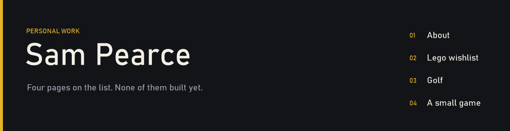

  

The list is the product. [portfolio](https://github.com/sjpearce29/portfolio) is a Next.js app whose home page is that list and nothing else.

| | Page | What it will be |
| --- | --- | --- |
| 01 | About | A CV, written in my own words |
| 02 | Lego wishlist | Sets I want, not a catalogue of everything I own |
| 03 | Golf | A small app for the game |
| 04 | A small game | Snake, or a platformer |

### Alongside the site

| | |
| --- | --- |
| [**spotify-widget**](https://github.com/sjpearce29/spotify-widget) | A Spotify control for while I'm working. The repository is a title and a sentence. |
| [**database-sandbox**](https://github.com/sjpearce29/database-sandbox) | A place to try SQL before it becomes part of something else. Empty. |
| [**python-sandbox**](https://github.com/sjpearce29/python-sandbox) | The same idea, for Python. Empty. |
| [**llm-learning**](https://github.com/sjpearce29/llm-learning) | A public log of learning language models. The first program sends a prompt and prints the reply. |

### What the site uses

  
  
  
  

